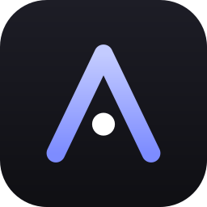
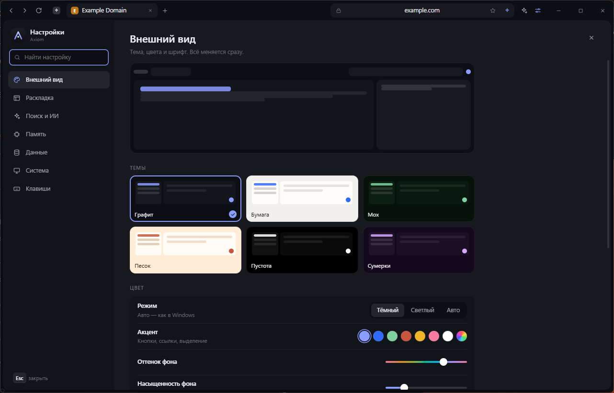

<p align="center">
  
</p>

<h1 align="center">Axiom</h1>

<p align="center">
  Лёгкий браузер на Rust. Минимум памяти, никакого лишнего шума<br>
  и Google AI Mode на расстоянии одного сочетания клавиш.
</p>

<p align="center">
  <a href="https://github.com/mylifeitsbest/axiom/releases/latest/download/Axiom-windows-x64.exe"><b>Windows</b></a> ·
  <a href="https://github.com/mylifeitsbest/axiom/releases/latest/download/axiom_amd64.deb"><b>Ubuntu / Debian / Kali</b></a> ·
  <a href="https://github.com/mylifeitsbest/axiom/releases/latest/download/axiom-x86_64.pkg.tar.zst"><b>Arch</b></a> ·
  <a href="https://github.com/mylifeitsbest/axiom/releases/latest">Все файлы</a>
</p>

<p align="center">
  
</p>

## Что умеет

- **Двойной поиск.** Запрос из адресной строки уходит в DuckDuckGo, а в боковой панели сразу отвечает Google AI Mode. Поиск внутри самой страницы DuckDuckGo тоже попадает в панель.
- **Панель ИИ** (`Ctrl+K`): регулируемая ширина, открепляется во вкладку, `Ctrl+Enter` в адресной строке спрашивает только ИИ.
- **Прокси только для ИИ.** HTTP или SOCKS5 применяется к одной панели AI Mode, вкладки ходят напрямую.
- **Экономия памяти.** Вкладки засыпают через N минут (по умолчанию 10) и полностью выгружаются, сохраняя адрес, заголовок и место прокрутки. Фоновые вкладки сразу переходят в экономный режим WebView2. Сессия восстанавливается лениво. Вкладки, где играет звук, не засыпают.
- **Настраивается как угодно.** 6 тем, свой акцент, оттенок и насыщенность фона, OLED-чёрный, 3 раскладки (одна строка, две строки, вкладки сбоку), скругления, отступы, шрифт, скорость анимаций, свой CSS, экспорт и импорт темы в JSON.
- **Перенос из Chrome**: закладки и история, Chrome можно не закрывать.
- **Закладки** (`Ctrl+D`), подсказки из истории и закладок, плитки частых сайтов на новой вкладке.
- **Браузер по умолчанию**: установка в профиль, регистрация в Windows, ссылки из других программ открываются вкладкой в уже запущенном окне.
- Горячие клавиши как в Chrome, поиск на странице, перетаскивание вкладок, восстановление закрытой вкладки (`Ctrl+Shift+T`).

## Установка

### Windows 10 и 11

Одной командой в PowerShell (скачает последний релиз, проверит SHA256 и установит без прав администратора):

```powershell
irm https://raw.githubusercontent.com/mylifeitsbest/axiom/main/install.ps1 | iex
```

Или вручную: скачайте [`Axiom-windows-x64.exe`](https://github.com/mylifeitsbest/axiom/releases/latest/download/Axiom-windows-x64.exe) и запустите. Файл не подписан, поэтому SmartScreen может предупредить: «Подробнее» → «Выполнить в любом случае». При первом запуске откроется приветствие: выбор вида, перенос из Chrome, «Установить» и выбор браузера по умолчанию.

Нужен WebView2 Runtime. В Windows 10 и 11 он уже есть.

Удаление: `axiom.exe --uninstall`, затем удалите папку `%LOCALAPPDATA%\Programs\Axiom` (профиль лежит в `%LOCALAPPDATA%\Axiom`).

### Ubuntu, Debian, Kali (apt)

```sh
wget https://github.com/mylifeitsbest/axiom/releases/latest/download/axiom_amd64.deb
sudo apt install ./axiom_amd64.deb
```

apt сам поставит зависимости (WebKitGTK 4.1). Подходит для Ubuntu 22.04 и новее, Debian 12 и новее, Kali Rolling. Удаление: `sudo apt remove axiom`.

### Arch, Manjaro, EndeavourOS (pacman)

```sh
sudo pacman -U https://github.com/mylifeitsbest/axiom/releases/latest/download/axiom-x86_64.pkg.tar.zst
```

Удаление: `sudo pacman -R axiom`. `PKGBUILD` лежит в [`packaging/arch`](packaging/arch/PKGBUILD), по нему можно собрать пакет самостоятельно (`makepkg -si`).

### Любой Linux одной командой

```sh
curl -fsSL https://raw.githubusercontent.com/mylifeitsbest/axiom/main/install.sh | sh
```

Скрипт сам выберет apt или pacman, скачает пакет из последнего релиза и проверит контрольную сумму. Для других дистрибутивов есть архив [`axiom-linux-x86_64.tar.gz`](https://github.com/mylifeitsbest/axiom/releases/latest/download/axiom-linux-x86_64.tar.gz) с бинарником, `.desktop`-файлом и иконками (нужен установленный WebKitGTK 4.1).

На Linux Axiom становится браузером по умолчанию кнопкой в настройках (через `xdg-settings`), а перенос данных работает и из Chrome, и из Chromium.

## Память

Axiom не пишет свой движок: страницы рендерит системный WebView. На Windows это WebView2, тот же Chromium, что в Edge. Поэтому открытая и активная тяжёлая вкладка весит примерно столько же, сколько в Chrome. Экономия набирается из другого:

| Откуда | Что даёт |
|---|---|
| Нет расширений, синхронизации и фоновых сервисов | интерфейс сам по себе ≈ 30–40 МБ |
| Спящие вкладки | неактивная вкладка — 0 МБ |
| Ленивое восстановление сессии | при запуске грузится только активная вкладка |
| Режим `MemoryUsageLevel::Low` для фоновых вкладок | WebView2 сбрасывает кэши невидимых страниц |
| Панель ИИ без прокси делит процессы со вкладками | минус целый набор служебных процессов (≈ 100 МБ) |

Замеры v0.1.0, release-сборка, Windows 11, чистый профиль. Считается private working set всех процессов браузера (`axiom.exe` и его `msedgewebview2.exe`), как столбец «Память» в Диспетчере задач:

| Сценарий | Память |
|---|---|
| Новая вкладка, без страниц | 87 МБ |
| Одна вкладка DuckDuckGo | 208 МБ |
| DuckDuckGo и панель AI Mode | 329 МБ |

Для сравнения: в ранней сборке, где у панели ИИ было отдельное окружение, тот же сценарий занимал около 495 МБ. Если включить прокси для ИИ, у панели снова появится своё окружение, и это примерно +100 МБ.

## Прокси для ИИ

Google AI Mode доступен не во всех странах. В «Настройки → Поиск и ИИ» укажите `socks5://хост:порт` или `http://хост:порт`.

Как это устроено: у панели ИИ своё окружение WebView2 со своей папкой данных и аргументом `--proxy-server`. Поэтому прокси действует только на панель и на вкладки, открепленные из неё, а обычные вкладки ходят напрямую. Адрес прокси строго проверяется, потому что попадает в аргументы запуска WebView2.

| Платформа | Прокси только для панели |
|---|---|
| Windows | работает |
| macOS | нужна macOS 14+ и сборка с фичей `mac-proxy` у wry (пока не включена) |
| Linux | WebKitGTK: прокси задаётся на уровне контекста, у панели ИИ свой контекст |

Обходной путь, если прокси на вашей платформе не работает: системный прокси или VPN с раздельным туннелированием только для `google.com`.

## Сборка из исходников

```powershell
git clone https://github.com/mylifeitsbest/axiom
cd axiom
cargo run            # debug: интерфейс читается с диска, правки ui/ видны без пересборки
cargo build --release
```

- **Windows**: [Rust](https://rustup.rs) и Visual Studio Build Tools с рабочей нагрузкой «Разработка классических приложений на C++». Через winget: `winget install Rustlang.Rustup Microsoft.VisualStudio.2022.BuildTools`.
- **Ubuntu, Debian, Kali**: `sudo apt install libwebkit2gtk-4.1-dev libgtk-3-dev libsoup-3.0-dev pkg-config build-essential`. Пакет: `cargo install cargo-deb && cargo build --release && cargo deb --no-build`.
- **Arch**: `sudo pacman -S --needed rust webkit2gtk-4.1 gtk3 libsoup3 base-devel`, пакет — `makepkg -si` в `packaging/arch`.
- **macOS** (не проверено): Xcode Command Line Tools (`xcode-select --install`).

Проверки, которые гоняет CI: `cargo fmt --check`, `cargo clippy --all-targets -- -D warnings`, `cargo test`.

Полезные флаги: `--check-chrome` (что будет перенесено из Chrome, без записи), `--install`, `--uninstall`. Переменная `AXIOM_PROFILE=<папка>` задаёт отдельный профиль, это и есть портативный режим.

## Устройство

```
src/
  main.rs          вход, один экземпляр, главный цикл tao
  app.rs           состояние браузера и обработка событий
  ipc.rs           протокол интерфейс ↔ Rust, проверка всех входящих команд
  tabs/            вкладки, адресная строка, создание webview
  ai_panel/        панель AI Mode и разбор прокси
  storage/         профиль, сессия, история, закладки, импорт из Chrome
  settings/        настройки
  system/          установка и регистрация в Windows
  ui/              раздача интерфейса по axiom://, горячие клавиши
ui/                интерфейс: HTML, CSS и чистый JS без фреймворков
assets/            логотип, иконка и скрипт, который их рисует
```

- Окно — `tao`, страницы — `wry` (WebView2, WKWebView, WebKitGTK). Интерфейс — отдельный служебный webview, вкладки и панель ИИ — дочерние webview поверх области контента. Раскладку задаёт интерфейс: он сообщает Rust прямоугольники, а Rust двигает нативные webview.
- **Безопасность IPC.** Обработчик IPC есть только у служебного webview, и он дополнительно проверяет адрес отправителя. Сайты во вкладках IPC не имеют вообще: заголовки, адреса и новые окна приходят через нативные события WebView2. Горячие клавиши на странице перехватываются нативно (`AcceleratorKeyPressed`), так что сайт не может их ни подделать, ни заблокировать. Интерфейс раздаётся со строгим CSP.
- Данные — JSON-файлы в `%LOCALAPPDATA%\Axiom`, история Chrome читается через SQLite.

## Ограничения и планы

- [ ] Блокировка рекламы и трекеров (движок `adblock` от Brave, EasyList и EasyPrivacy)
- [ ] Страницы закладок, истории и загрузок
- [ ] Индикатор памяти по процессам браузера
- [ ] Пароли и входы из Chrome не переносятся: Chrome шифрует их ключом, привязанным к самому Chrome. Axiom предлагает сохранить пароль при входе.
- [ ] Страница во вкладке остаётся прямоугольной: дочерний WebView2 нельзя скруглить без перехода на композиционный хостинг.
- [ ] Linux-пакеты собираются и проходят тесты в CI (Ubuntu 22.04, Arch), но вживую на рабочем столе Linux пока не прогонялись. Сообщайте о проблемах в Issues.
- [ ] macOS пока не поддерживается сборками.
- [ ] Свой репозиторий APT и pacman для обновлений через `apt upgrade` и `pacman -Syu`.
